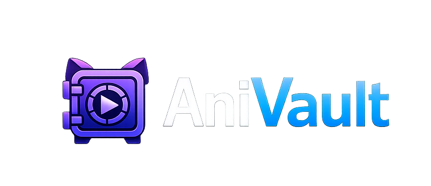

<p align="center">
  
</p>

<h1 align="center">
  
  AniVault
</h1>

<p align="center">
  <b>A Windows anime library and tracker.</b><br />
  Tracks what you watch, organizes your files, and syncs to AniList and Sonarr.
</p>

<p align="center">
  
  
  
  
  
  
</p>

---

> [!IMPORTANT]
> **AI-generated project.** AniVault is written and maintained with Claude (Anthropic).
> Review the code before relying on it.

AniVault sits in the tray, notices when you play an episode, and updates your AniList progress
for you. It also indexes your local anime folders and works with Sonarr to fill the gaps. It's a
modern take on [Taiga](https://github.com/erengy/taiga).

## Download

Get `AniVault_<version>_x64-setup.exe` from the
[latest release](https://github.com/nosut/AniVault/releases/latest). To upgrade, install over the
old version; your library is kept. AniVault tells you when an update is out.

## Features

### ▶️ Watching
- Detects the episode playing in common players (mpv, VLC, MPC-HC, PotPlayer and more).
- Progress, history and AniList update automatically.
- **Continue** on any series page plays the next episode, or carries on a rewatch.
- **Now Playing** page: click any episode to play it, with Previous / Next / Replay.
- **Up Next** offers the next episode when one ends.

### 🏠 Home
- Airing today, ready to watch, and missing downloads at a glance.
- Lists Watching and Planning shows that Sonarr doesn't have yet.

### 📚 Library
- Scans your folders and matches files to shows.
- Library in table or poster view, grouped by season, with airing countdowns.
- Plan to Watch marks shows that have started airing or premiere soon.
- Collection view with disk usage, and a File Manager for fixing matches.


### 🔗 AniList
- Sign in and import your list in one click.
- Changes sync in the background and retry if AniList is down.
- Detail pages with progress, score, history and related entries.
- **Seasons** page for browsing any season.


### 📺 Sonarr
- Imports and syncs your series every 30 minutes.
- Add a missing show to Sonarr, or link one it already has.
- Search for missing episodes from the home page.
- Dropping or removing a show can unmonitor it and clean up its files.
  Pick it back up later from the **Unmonitored** tab.

### 📅 Calendar
- Month and agenda views of upcoming episodes, with watched ones checked off.

### 🛡️ Everything else
- Watch history and stats.
- Backup, restore, JSON export, and Taiga import.
- Credentials encrypted with Windows DPAPI.
- Clear error messages with a Try again button.
- Tray icon and optional launch on startup.

## Building from source

Needs Windows, [Node.js](https://nodejs.org/), [Rust](https://rustup.rs/) with the MSVC build
tools, and the Tauri CLI (`cargo install tauri-cli --version "^2"`).

```powershell
cd next
npm install
cargo tauri dev   # run in development
npm run verify    # typecheck, tests, cargo check
npm run bundle    # build the installer
```

Rust tests: `cargo test` in `next/src-tauri`.

## Credits

Based on [Taiga](https://github.com/erengy/taiga) by [Eren Okka](https://github.com/erengy).
AniVault is an independent reimplementation, not affiliated with the original.

## License

[GPL v3](LICENSE), the same as Taiga.
